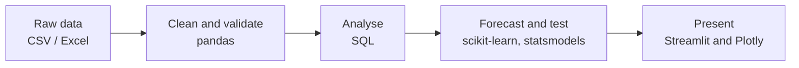

  

**Aspiring Data Analyst • Python Developer**

<!-- Optional: add your portfolio or resume link
 -->

---

## 💫 About me

- 🎓 BE Computer Science and Engineering - 2026
- 📊 Aspiring data analyst and Python developer who likes turning messy data into clear, trustworthy insights
- 🔧 Built an end-to-end **sales analytics and forecasting dashboard** with Python, SQL and Streamlit
- 🧪 I care about testing results honestly, for example comparing forecasts against a simple baseline instead of trusting a single model
- 💬 Ask me about: data cleaning, SQL analytics, time-series forecasting and backtesting, Streamlit

**Mission:** Turning raw data into clear, reliable decisions.

## ⚡ Tech stack

| Area | Tools and skills |
| --- | --- |
| Programming | Python, SQL (SQLite) |
| Data analysis | pandas, NumPy, data cleaning, KPI analysis, ABC analysis, anomaly detection |
| Visualisation | Plotly, Streamlit dashboards |
| Forecasting | scikit-learn, statsmodels, Holt-Winters, rolling-origin backtesting, prediction intervals |
| Quality | pytest, SQL-injection-safe queries, independent result checks |
| Tools | Git, GitHub, GitHub Actions, VS Code |

<!-- Add other tools here only if you can discuss them in an interview (for example Excel, Power BI, Tableau). -->

## 🏗️ How I work

## 🚀 Featured project

### 📈 [Sales Analytics Dashboard with Forecasting](https://github.com/[YOUR-USERNAME]/sales-dashboard)

An interactive dashboard that cleans raw sales data, analyses it with SQL and forecasts future sales. Several forecasting models are compared with backtesting against a seasonal baseline, and the best one is selected automatically and shown with a prediction interval.

**Tech:** Python • pandas • SQL (SQLite) • scikit-learn • statsmodels • Streamlit • Plotly • pytest • GitHub Actions

**Highlights**
- Data-cleaning pipeline with a quality report: duplicates, returns, missing values and outliers
- SQL analytics with filters: KPIs, trends, ABC analysis, new vs returning customers, anomaly detection
- Rolling-origin backtesting of five models; on the real Superstore dataset the best model reached **23.1% MAPE and 9% lower RMSE than a seasonal-naive baseline**
- 48 automated tests, including checks for SQL-injection protection and data leakage in backtesting

[🔗 View project](https://github.com/[YOUR-USERNAME]/sales-dashboard)

<!-- Add more projects here in the same format as you build them. -->

## 🌱 Currently working on

- Improving the forecasting dashboard (more models such as SARIMA and XGBoost, holiday features)
- Strengthening SQL and Python problem-solving
- Building more end-to-end data projects

<!-- Edit this list so it matches what you are really doing. -->

## 🏆 Strengths

✅ Data cleaning &nbsp;&nbsp; ✅ SQL analytics &nbsp;&nbsp; ✅ Time-series forecasting and backtesting &nbsp;&nbsp; ✅ Writing tests &nbsp;&nbsp; ✅ Python &nbsp;&nbsp; ✅ Clear documentation

## 📫 Connect with me

<!-- Optional GitHub stats. Add them later, once you have more activity, and check that the images load:

-->

---

⭐ Thanks for stopping by!

*Clean data, honest evaluation, clear results.*

